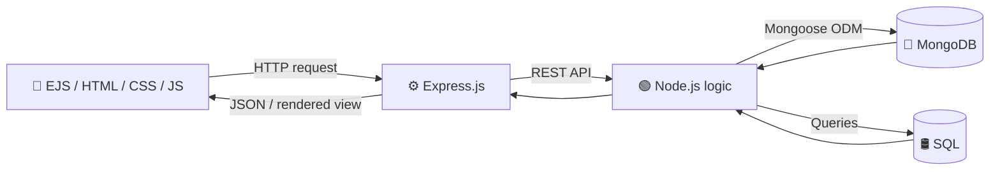

<!-- ===================== ANIMATED HEADER ===================== -->
<div align="center">


<a href="https://github.com/Arihant-rgb">
  
</a>

<br/>


</div>

---

## 👨‍💻 About Me

```js
const arihant = {
  role: "Full-Stack Developer",
  education: "B.E. Computer Science & Engineering @ MSRIT, Bengaluru (2029)",
  location: "Bengaluru, India 🇮🇳",
  currentlyLearning: ["Advanced Node.js", "Database design", "System design basics"],
  currentlyBuilding: "REST APIs & full-stack web apps",
  funFact: "I debug with console.log and I'm not ashamed 😄",
};
```

---

## 🛠️ Tech Stack

<div align="center">

### 💻 Programming


### 🎨 Frontend


### 🧩 Backend


### 🗄️ Databases


### 🧠 Concepts


### 🔧 Tools


</div>

---

## 🔄 How I Build

<div align="center">



</div>

---

## 📊 GitHub Stats

<div align="center">


<br/>


<br/>


</div>

---

<!--
🐍 OPTIONAL: contribution snake animation.
1. Add .github/workflows/snake.yml (provided separately)
2. Run it once from the Actions tab
3. Then uncomment the block below

<div align="center">
  
</div>
-->

## 📬 Connect With Me

<div align="center">

[](https://www.linkedin.com/in/arihant-patil-87bb71389)
[](mailto:arihantannapatil@gmail.com)
[](https://github.com/Arihant-rgb)
[](https://leetcode.com/Arihant-rgb)

<br/>


</div>
